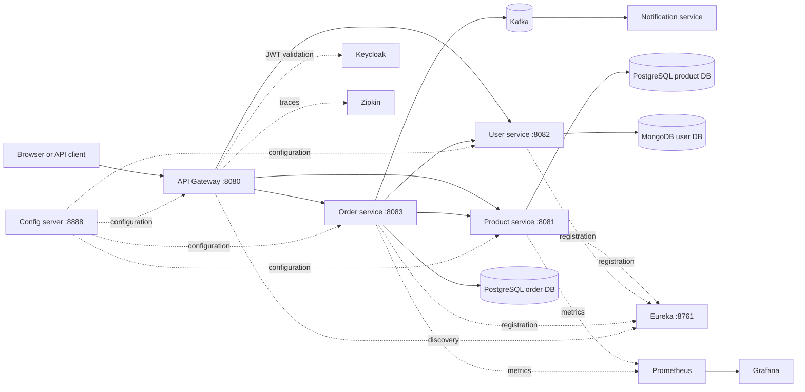

# E-Commerce Microservices Interview Companion

This repository is a hands-on Spring Boot microservices project and a structured set of notes for revising a Java developer interview. The runnable code is the source of truth; the [`docs/`](docs/) tree explains the architecture, the reasoning behind each technology, the important implementation details, and the production gaps that are worth discussing in an interview.

The notes are intentionally organized as a zero-to-hero path. You can read them in order after completing the course, or jump directly to a topic such as Kafka, Keycloak, resilience, Kubernetes, or observability.

## What is in this repository?

The main application is split into independently built services:

| Component | Responsibility | Port |
|---|---|---:|
| `gateway` | Reactive API gateway, routing, JWT resource-server security, rate limiting, retries, circuit-breaker fallback | 8080 |
| `product` | Product catalog and inventory fields backed by PostgreSQL | 8081 |
| `user` | User profile persistence in MongoDB and Keycloak administration integration | 8082 |
| `order` | Cart and order management in PostgreSQL; synchronous service calls and order event publication | 8083 |
| `notification` | Kafka consumer for `OrderCreatedEvent` | 8084 |
| `configserver` | Spring Cloud Config native server and refresh bus integration | 8888 |
| `eureka` | Service registry and discovery server | 8761 |

Supporting infrastructure is defined in [`deploy/docker/docker-compose.yml`](deploy/docker/docker-compose.yml): PostgreSQL, MongoDB, Kafka, ZooKeeper, RabbitMQ, Keycloak, Zipkin, Prometheus, Grafana, Loki, and Grafana Alloy.

The [`additional/`](additional/) tree contains focused demonstrations for Spring Boot basics, configuration management, inter-service clients, Kafka functions, OAuth2 flows, and a monolithic e-commerce application.

## Architecture at a glance



## Read the notes in this order

1. [`docs/README.md`](docs/README.md) — navigation, setup, and implementation status.
2. [`docs/reference/service-catalog.md`](docs/reference/service-catalog.md) — ports, endpoints, dependencies, and source map.
3. [`docs/01-microservices-foundations/README.md`](docs/01-microservices-foundations/README.md) — architecture and design vocabulary.
4. [`docs/02-spring-boot-and-rest/README.md`](docs/02-spring-boot-and-rest/README.md) — Spring Boot request flow and API design.
5. [`docs/03-domain-design-and-data/README.md`](docs/03-domain-design-and-data/README.md) — bounded contexts, persistence, and decomposition.
6. [`docs/04-service-discovery-and-config/README.md`](docs/04-service-discovery-and-config/README.md) — Eureka and Config Server.
7. [`docs/05-api-gateway/README.md`](docs/05-api-gateway/README.md) — routing, filters, and edge security.
8. [`docs/06-interservice-communication/README.md`](docs/06-interservice-communication/README.md) — RestClient, HTTP interfaces, Feign, and WebClient.
9. [`docs/07-event-driven-architecture/README.md`](docs/07-event-driven-architecture/README.md) — Kafka, Spring Cloud Stream, events, and delivery guarantees.
10. [`docs/08-security-and-keycloak/README.md`](docs/08-security-and-keycloak/README.md) — OAuth2, JWT, Keycloak, PKCE, and client credentials.
11. [`docs/09-resilience-and-reliability/README.md`](docs/09-resilience-and-reliability/README.md) — timeouts, retries, circuit breakers, rate limits, and sagas.
12. [`docs/10-observability/README.md`](docs/10-observability/README.md) — logs, metrics, traces, and dashboards.
13. [`docs/11-testing-and-quality/README.md`](docs/11-testing-and-quality/README.md) — unit, integration, contract, and end-to-end testing.
14. [`docs/12-docker-and-local-platform/README.md`](docs/12-docker-and-local-platform/README.md) — images, Compose, networking, and local operations.
15. [`docs/13-kubernetes/README.md`](docs/13-kubernetes/README.md) — Kubernetes concepts and a deployment blueprint. This repository does not yet contain tracked Kubernetes manifests.
16. [`docs/14-production-architecture/README.md`](docs/14-production-architecture/README.md) — production hardening, CI/CD, payments, and migration gaps.
17. [`docs/15-interview-playbook/README.md`](docs/15-interview-playbook/README.md) — project explanation, questions, and answer frameworks.

## Quick local orientation

Prerequisites: Java 21, Docker Desktop, and a shell that can run the Maven wrappers. The primary modules are independent Maven projects rather than one Maven reactor.

```bash
# Compile one service and run its tests
cd product
./mvnw test

# Build all primary service JARs without tests
cd ../deploy/docker
./build-projects.sh

# Start the local infrastructure/application composition
docker compose up -d
docker compose ps
```

Before starting the full Compose stack, read [`docs/12-docker-and-local-platform/README.md`](docs/12-docker-and-local-platform/README.md). The checked-in Compose file references published `dcode007/*` images and expects environment variables. The default and Docker-specific database profiles use different names, so verify the active profile before treating the stack as a clean production-like bootstrap.

## Important scope note

The course syllabus covers more than this checkout currently implements. The notes explicitly mark these boundaries:

- **Implemented in the main application:** gateway, Eureka, Config Server, PostgreSQL/MongoDB services, synchronous calls, Kafka order notification, Keycloak integration, resilience configuration, tracing, metrics, and Docker Compose.
- **Demonstrated under `additional/`:** REST client alternatives, Kafka function examples, OAuth2 authorization-code/PKCE/client-credentials examples, configuration management, and a monolith.
- **Documented as production blueprints but not shipped as complete runtime code:** payment service, Kubernetes manifests, a transactional outbox, distributed saga orchestration, schema registry, centralized secrets, CI/CD workflows, and a full integration/contract test suite.

That distinction is useful in interviews: explain the current code accurately, then describe how you would take it to production.

## Course context

These notes are an original study guide built around the repository's code and the course topics. They do not replace the course, and paid videos, slides, or other proprietary course material should not be redistributed. Use the source code and these notes for personal learning and interview preparation.
